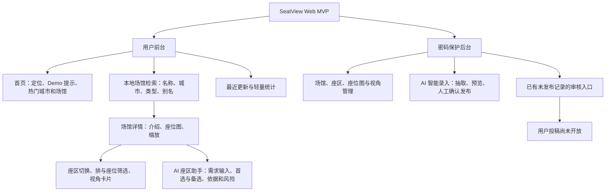
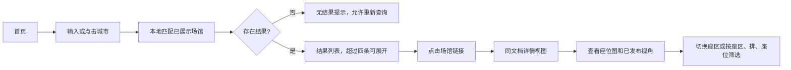
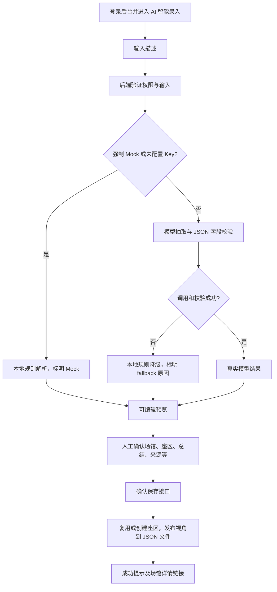
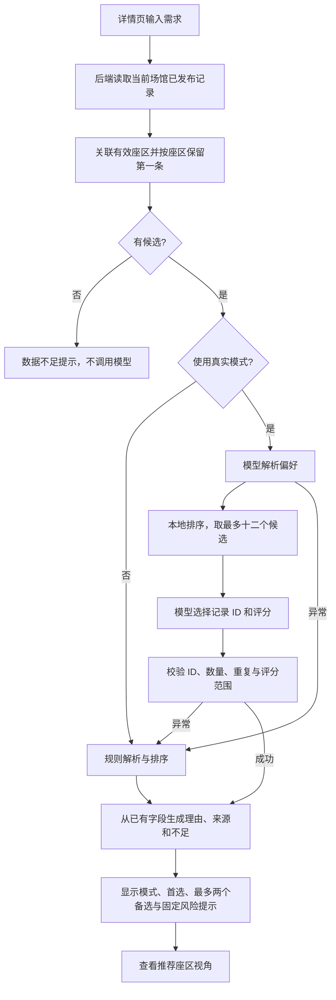
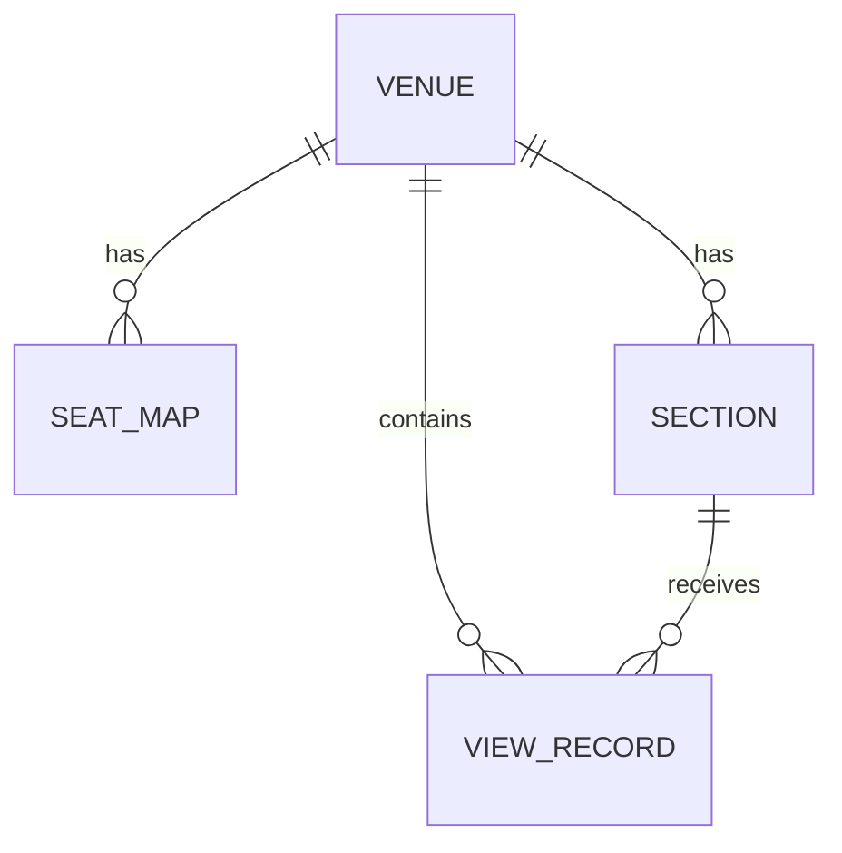

# 演唱会座区智能决策平台——产品需求文档（PRD）

> 文档版本：现状基线 1.0；核查日期：2026-10-09。依据当前工作区代码，而非仅依据初始 Git 提交。本文描述个人 Web MVP；用户需求、画像、指标和未来方案均为设计假设或待验证方案，没有用户调研或运营效果数据。技术细节见 [AI 技术方案](Concert_Seat_AI_Technical_Design.md)，验证范围见 [现状核查](Concert_Seat_AI_Project_Audit.md)。

## 1. 产品概述

|项目|定义|
|---|---|
|产品名称|SeatView 演唱会座区智能决策平台|
|产品定位|面向演唱会观众的场馆视角查询与 AI 辅助选区平台，用图片、结构化评价和受已有数据约束的推荐支持购票前判断。|
|背景假设|座位图难以直接反映距离、侧视角、遮挡和拍摄体验，分散的观演描述也不便于横向比较。该假设尚未经正式访谈验证。|
|目标用户|普通购票观众、重视舞台体验或拍摄的观众，以及维护内容的运营人员。|
|核心价值|将场馆检索、座区信息比较和偏好推荐连成一条路径；将运营描述抽取为可编辑字段，再由人工确认发布。|
|产品形态|原生 HTML/CSS/JavaScript 的 Web 前台与密码保护后台，由同一 Node 服务提供页面和 API。|
|MVP 范围|保留搜索、座位图、视角和后台 CRUD；围绕一个完整南京 Demo 展示 AI 智能录入和 AI 座区助手。|

当前数据快照为 **21 个场馆、3 张座位图、6 个座区、7 条视角记录**，不是 21 个场馆均有完整内容。南京奥林匹克体育中心体育场含 A3、A5、B1、C2、D4 五个座区、五张示意视角插画及六条评价，其中一条 A3 是 Mock 解析后人工确认的演示记录。座位图与插画不应作为真实观演照片展示成果；原有鸟巢和青岛资料仍保留，其内容真实性和授权并未独立核验。

## 2. 用户需求与痛点分析

以下均为产品设计假设，待通过访谈、任务观察和试用验证。

|假设痛点|典型场景|核心需求|当前解决方式|仍待验证的问题|
|---|---|---|---|---|
|信息分散、检索耗时|用户在购票前反复查找同一场馆信息|按场馆集中查看内容|本地场馆搜索、详情与来源展示|是否愿意从原平台迁移到独立查询工具|
|座位图无法解释现场体验|第一次进入大型体育场|理解距离、观看角度和遮挡|座位图旁提供座区卡片|示意图与少量记录是否足以支持决策|
|描述口径不统一|比较“很近”和“侧面不错”等评价|采用相同字段对比|距离、角度、遮挡、拍摄友好度与标签|主观分级的一致性和跨演出可比性|
|偏好不同，比较成本高|拍直拍与正面看舞台的用户选区不同|将个人需求映射到现有信息|自然语言偏好解析与候选推荐|推荐是否真正减少完成任务的步骤|
|手工录入重复|运营处理长段观演描述|降低初次整理成本且保留审核|AI 抽取、可编辑预览、人工保存|节省时间是否被复核成本抵消|

建议先访谈少量目标用户并记录具体购票任务，再验证信息可信度、必要字段和推荐解释是否足够。不能将这些假设表述为“用户已经证实”。

## 3. 用户画像与使用场景

|设计假设画像|目标与场景|需求与主要痛点|对应功能|
|---|---|---|---|
|首次购票的普通观众|搜索已知场馆，判断有哪些可比较的座区|不熟悉分区名称，希望快速理解图片和评价；缺少数据时容易误判|搜索、数据状态、座位图、结构化卡片及 Demo 提示|
|重视观看体验的观众|在正面角度与距离之间做取舍|想知道侧面或远距离带来的不足，单看座位图难以判断|角度/距离字段、AI 偏好推荐、风险提示|
|重视拍摄的追星用户|表达“近延伸台、无遮挡、拍直拍”等需求|关注拍摄条件和遮挡，描述口径不一致|拍摄字段、已有标签、推荐来源与查看座区视角|
|后台运营人员|把一段描述整理并发布到正确场馆|重复录入多字段，担心模型猜测地点或遗漏信息|密码登录、AI 智能录入、手工修改、视角管理|

## 4. 产品功能架构

首页搜索与 AI 推荐是不同能力：搜索在浏览器内匹配已有场馆，不调用大模型。投稿按钮仅提示 MVP 未开放；`xhsDrafts` 数组与审核界面不是自动抓取或完整 UGC 系统。

## 5. 核心用户流程

### 5.1 场馆查询

详情地址为 `/?venue=场馆ID#viewer`。这不是独立前端路由框架；浏览器返回和刷新通过 URL 与 History 状态恢复，返回首页保留搜索词。缺失或下架场馆回到可用首页并提示。

### 5.2 AI 智能录入

解析不会自动写库。保存直接生成“已发布”记录，人工确认就是此链路的审核节点，尚无独立二次审批流程。

### 5.3 AI 座区推荐

## 6. 详细功能需求

以下验收标准描述预期可验收行为，不等于每项浏览器交互均已在本次重新测试。具体证据范围见核查文档。

### 6.1 场馆搜索与结果展示

**背景及场景：** 用户知道城市、场馆名称或简称，需要快速找到已维护场馆，避免在首页长列表中逐项查找。

|要素|当前需求与实现|
|---|---|
|入口、触发、输入|首页搜索框、查询按钮、Enter、快捷词或热门城市；输入城市、名称、类型、别名或组合关键词。|
|业务逻辑|`assets/venue-search.js` 对大小写、空格、奥林匹克/奥体简称等归一化；结合直接包含匹配与中文有序模糊匹配。多个空格分隔词须全部匹配。排除已下架场馆。不是语义检索。|
|输出|紧邻输入框展示名称、城市、类型及数据状态；默认四条，允许展开全部。|
|交互|160ms 防抖，兼容中文输入法；按钮与 Enter 立即查询。搜索期间隐藏热门和辅助内容，清空后恢复。结果为普通链接，支持 Tab 与 Enter。|
|异常|无匹配时显示提示；空输入恢复首页；不存在或下架详情地址返回首页。服务端加载失败不应被当作成功获取最新数据。|
|验收标准|“北京”“鸟巢”“国家体育场”“南京奥体中心”“南京体育场”等可匹配；无结果不自动进入场馆；清空恢复内容；返回保留关键词；搜索不发送 AI 请求。|
|代码依据|`index.html`、`app.js` 的 `search/selectVenue/showHome/restoreFrontRoute`、`assets/venue-search.js`。|

### 6.2 场馆详情与座区信息

**背景及场景：** 用户进入场馆后，需要把座位图与观演评价联系起来，并比较不同座区的信息。

|要素|当前需求与实现|
|---|---|
|入口与输入|场馆链接或详情深链接；座区按钮、座区/排/座位筛选输入。|
|业务逻辑|读取当前场馆，选择默认座位图；展示关联座区，视角只展示“已发布”。默认选中座区，允许查看全部或按字段包含匹配筛选。|
|输出|名称、城市、介绍、地图；图片为主体的视角卡片，包含距离、角度、遮挡、拍摄友好度、标签、评价、来源和已有创建时间。旧记录缺失字段显示“待补充”。|
|交互|桌面座位图与 AI 输入并排，移动端上下布局；缩放范围 0.75–1.35；选区更新卡片。推荐结果单独置于卡片下方。|
|异常|无座位图、无座区或无已发布视角各有空态；未发布内容不作为前台卡片显示。|
|验收标准|南京五个座区可切换并查看示例卡片；鸟巢与青岛原资料保留；不同场馆不串数据；筛选无结果有提示；缺少图片时仍可查看文字。|
|代码依据|`app.js` 的 `renderSeatMap/renderDetail/getFilteredVenueRecords/renderFrontRecordCard`，`styles.css`、`data/db.json`。|

座区按钮位置由索引生成网格，不是实景地图标定。拍摄星级由文字正则映射：较好/优秀为四星，较差为两星，其余已有描述为三星，不是用户评分均值。旧记录可能没有 `createdAt`，不能保证每张卡片都显示时间。地图与场次布局的对应尚未标准化。

### 6.3 AI 智能录入

**背景及场景：** 运营粘贴一段观演经验，先获得字段初稿，再核对和补充，减少重复填写的步骤。

|要素|当前需求与实现|
|---|---|
|入口与触发|后台侧栏 AI 智能录入，或视角管理内入口；点击“AI 解析”。须已登录。|
|输入|原始描述，非空且后端最多 5000 字符；模型同时获得已知场馆名称。|
|业务逻辑|独立 AI 服务调用抽取 Prompt；校验字符串/null、标签数组与置信度范围。无 Key 或强制 Mock 使用规则；调用/格式失败自动降级并提示。|
|解析输出|场馆名称、座区、距离、角度、遮挡、拍摄友好度、标签、总结、置信度；未知字段可为空。|
|预览交互|显示可编辑场馆选择、座区及结构化字段、逗号分隔标签、总结；可填写来源与上传图片。置信度仅作参考，不是准确率。未确认不保存。|
|保存逻辑|必须选择已有场馆、填写座区和总结；服务端按场馆及座区名称复用或创建座区，兼容新旧视角字段，并写入已发布记录。图片可缺省。|
|保存输出|成功提示、场馆详情直达链接；重新加载服务端状态。其他前台页在重新获得焦点时刷新。|
|异常|空输入提示“请先输入观演描述。”；前后端请求失败提示重试；AI JSON/字段错误返回带原因的 fallback；保存验证或权限失败显示失败信息。|
|防重复|请求期间禁用对应按钮；没有服务端幂等键，再次主动保存同一内容仍可能重复。|
|验收标准|解析后数据库不变；未知场馆须人工选择；人工修改后的值保存并显示到前台；模式提示可区分 live、mock、fallback；缺少必填字段不保存。|
|代码依据|`admin.html`、`ai-ui.js`、`server.js` 三个 AI 接口、`services/aiService.js` 与 `services/prompts.js`。|

AI 提供整理建议，不能证明观演经历真实。当前保存来源可由人工填写，尚无来源验证和正式内容审核标准。

### 6.4 AI 座区推荐

**背景及场景：** 用户表达正面观看、近舞台、拍摄、无遮挡或延伸台需求，系统帮助比较当前场馆已维护的信息。

|要素|当前需求与实现|
|---|---|
|入口与触发|详情页顶部 AI 入口聚焦需求框，用户点击“帮我选座”；不要求登录。|
|输入|自然语言需求和当前场馆 ID；非空且最多 5000 字符。|
|候选业务规则|后端只读取当前非下架场馆的已发布视角，关联同场馆座区；每个座区按存储顺序取第一条记录，不聚合多条评价。|
|输出|首选最多一个、备选最多两个；每项含座区、推荐指数、已有字段理由、不足、来源以及查看视角按钮。|
|交互|Loading 与按钮禁用；完成后定位当前场馆推荐结果。切换场馆使旧结果失效，旧请求仍可能完成但不会写入新页面。|
|异常|零候选显示“当前场馆暂无足够座区数据，暂时无法进行 AI 推荐。”；单候选不生成备选。网络或校验失败显示 fallback 并使用规则；前端请求失败可再次点击。|
|验收标准|推荐 ID 均在允许候选中；不重复推荐；评分为 1–5 整数；不输出虚构票价；理由能对应原记录；未知/下架场馆不推荐；保留来源和数据不足提示。|
|代码依据|`server.js` 推荐接口、`services/aiService.js` 的 `recommend`、`ai-ui.js`。|

当前“解释”是字段证据展示，不是模型生成的个性化推理；推荐指数也不是满意率。Prompt 允许首选为 null，但真实结果校验要求首选非空，因此有数据却无适合座区时不能可靠拒答，可能降级后仍给出首选，这是后续必须补齐的限制。

### 6.5 后台管理

**背景及场景：** 单运营维护场馆、座位图和视角，完成 MVP 数据冷启动和内容发布。

|要素|当前需求与实现|
|---|---|
|入口与输入|`/admin.html`，未登录重定向登录页；密码登录后进入 Dashboard 与各管理面板。|
|场馆管理|新增、编辑、删除；城市、名称、类型、容量、地址、介绍、封面、热门和状态字段。前台排除“已下架”。|
|地图与座区|上传座位图、设置默认、删除；座区新增、编辑、删除。上传图片转换为 Data URL 存入 JSON。|
|视角管理|新增、编辑、删除、发布状态维护；原排、座位、艺人、活动、来源链接与标签继续保留，加入结构化体验字段。|
|业务处理|普通管理在前端维护数组后调用整库 `/api/state` 保存；删除场馆连带删除图、座区及视角，删除座区连带删除视角。AI 保存使用独立服务端追加接口。|
|输出与交互|刷新列表、统计和表单；异步保存期间禁用提交。审核列表可编辑已有未发布记录，公开投稿仍未开放。|
|异常|登录错误、未授权写入、保存失败显示提示；服务重启会清空内存会话，需重新登录。|
|验收标准|未登录不能加载后台或写入；维护结果刷新后持久；默认地图可显示；级联删除不留下相关视角；上传与编辑仍保留原字段。|
|代码依据|`admin.html`、`login.html`、`app.js` 的管理表单、`server.js` 会话与状态接口。|

单密码、内存会话、整库同步写入仅适合受控 Demo。当前公开 GET `/api/state` 返回全部数组，包括未发布数据；前台隐藏未发布内容不等于接口隔离。本次文档任务未修改此行为。

### 6.6 首页辅助模块与预留入口

热门城市点击后直接填入查询；热门场馆默认六条，可展开，旧数据未声明 `isHot` 时兼容展示。统计来自当前数组，不是活跃用户或业务效果。最近更新取已发布记录倒序尾部数据，不构成严格时间排序的运营推荐。投稿弹窗明确未开放，不能列为完整用户投稿功能。

## 7. 数据结构与业务规则

### 7.1 实体与字段

|实体/位置|主要字段|用途和限制|
|---|---|---|
|`venues`|id、city、name、type、capacity、description；可选 address、coverImage、isHot、status、aliases|场馆主数据，旧记录不一定包含全部字段；容量有待核验值。|
|`seatMaps`|id、venueId、name、url、type、sourceNote、uploadedAt、isDefault；部分记录 sourceUrl/note|同场馆可多图，前端优先默认图；不是每场演出布局模型。|
|`sections`|id、venueId、name、sectionType、level、position、note；部分旧记录 isFloor/isStand|座区实体；AI 自动创建记录只维护必要字段，没有地图坐标。|
|`viewRecords`|id、venueId、sectionId、row、seatNo、artist、eventName、publishedAt、imageUrl、reviewText、sourcePlatform、sourceUrl、tags、status|原有评价和图片信息，发布状态决定前台可见性。|
|视角扩展字段|venueName、section、image、stageDistance、viewingAngle、obstruction、shootingFriendly、description、source、createdAt、rawDescription|新旧字段兼容；不是每条旧数据都具备所有扩展字段。|
|`xhsDrafts`|当前为空数组|数据结构预留，不代表社交平台采集能力。|
|AI 抽取结果|venueName、section、四类体验字段、tags、summary、confidence|临时可编辑结果，保存前不持久；confidence 不作为当前推荐权重。|
|AI 推荐结果|preferences、primary、alternatives、notice；外层 data、mode、warning|首选/备选含 recordId、sectionId、section、score、reasons、disadvantages、source。|

关系由 JSON 字段及业务代码维持，没有数据库外键约束。AI 预览的 summary 保存为 description 和 reviewText；来源保存为 source 和 sourcePlatform；图片保存为 image 和 imageUrl。模型抽取置信度当前不存入视角记录，也没有模型版本、调用时间和审核人审计字段。

### 7.2 关键业务规则

1. 推荐不能跨场馆，不能选择不存在或未发布的记录；同区多记录当前仅选第一条。
2. 智能录入必须人工确认已有场馆，座区名称和总结非空；可以没有图片，不得把缺失图片补成真实照片。
3. 结构化字段可为 null；前台显示待补充，推荐理由跳过缺失字段。字段为自由文本，尚未形成稳定枚举标准。
5. Demo 来源、模式与风险提示必须可见；Mock 固定置信度及星级不能解释为统计效果。
6. 整库保存没有事务、版本冲突检测或幂等去重；多运营并发可能覆盖更新。

## 8. MVP 范围与产品迭代

Git 当前仅有 `4e54a61 Initial SeatView MVP` 一个提交；现有扩展在工作区中，不能据此确认三个正式发布版本或开发日期。以下 V1–V3 是按能力拆分的产品叙述框架，不是虚构发布记录。

|阶段框架|能力|事实状态|
|---|---|---|
|V1：信息查询|搜索、场馆详情、座位图、视角与后台维护|代码存在且基础接口/搜索回归通过，初始提交支持基础 MVP 来源。|
|V2：内容结构化|独立模型服务、Prompt、智能录入、人工确认及发布|代码链路完整；Mock 及存储接口已验证，真实抽取本次未在线验证。|
|V3：辅助决策|偏好解析、限定候选推荐、证据与风险展示|代码链路完整；已有报告记载真实 OpenRouter 推荐成功，本次验证采用模拟上游与 Mock。|
|下一阶段，未实现|来源核验、冲突评价聚合、无合适候选拒答、埋点与评估|建议先做，不宣称完成。|

MVP 排除大规模爬虫、社交内容自动下载、实时票价票务、支付、模型训练、复杂 RAG、向量数据库、App、小程序与登录体系大改。

## 9. 产品指标与效果评估

当前没有埋点、真实用户样本、系统化标注集、Token 消耗或成本台账。以下仅为采集与评估设计；实施前统一会话、去重、时间窗及 live/mock/fallback 口径。

|指标|定义与计算|建议采集/评估方式|
|---|---|---|
|搜索成功率|返回至少一个匹配的有效搜索次数 / 有效搜索次数|记录 search_submit、result_count；排除空输入；同时审查是否找到目标，避免“有结果”代替相关性。|
|详情访问转化率|点击结果并进入详情的搜索会话 / 有结果搜索会话|search_session_id 串联查询与 venue_open。|
|AI 抽取成功率|真实模型输出通过格式/字段校验次数 / 真实抽取请求次数|服务端分别记录上游成功、格式通过与业务通过；fallback 不计真实成功。|
|结构化字段准确率|与标注一致的字段数 / 被评估字段数|独立标注和复核，区分 null 正确、错误补全与遗漏，允许语义等价答案。|
|人工修改率|有至少一个人工字段修改的保存记录 / 进入确认并保存的记录|保存抽取快照与人工最终值；目前未持久保留完整初稿，需补充。|
|AI 推荐有效率|被评审判定合法且符合明确偏好的推荐任务 / 有可用候选的评估任务|先检查硬合法性，再由人工盲评偏好匹配，不以点击代替有效。|
|用户任务完成率|完成指定查询/选区任务的人次 / 开始该任务的人次|受控试用定义完成条件，例如查看证据后选定一个区；不等于购买转化。|
|AI 接口响应时延|请求开始到最终结果的时长，报告 P50/P95|分上游单调用与端到端、模式、模型和候选数；同时记录超时和失败。|

访谈与任务试用先获得问题和可用性反馈；标注集评估验证模型输出；最后才进行线上效果测量。没有采集结果前，简历可写“设计指标体系”，不能写准确率提升或转化率增长。

## 10. 后续优化方向

**优先级 P0：信息与输出可控。** 将发布态数据和管理数据接口隔离；补充推荐空首选合法处理、低信息候选门槛和明确偏好不足提示；统一体验字段枚举与数据证据，避免把主观文字直接当精确分级。

**优先级 P1：可信冷启动和评价聚合。** 先完善少量高需求场馆，给图片、场次、舞台布局、来源授权及核验状态建立字段。按场次与座区聚合多条评价并展示冲突；保留不同体验，而不是仅采用第一条记录。以上尚未实现。

**优先级 P2：稳定性与必要的能力升级。** 在并发需求出现后引入原子写入/版本冲突控制、请求限流和持久会话；确有多步查证需求后再评估轻量工具助手。实时票价、商业化和复杂 Agent 不属于本次成果。
